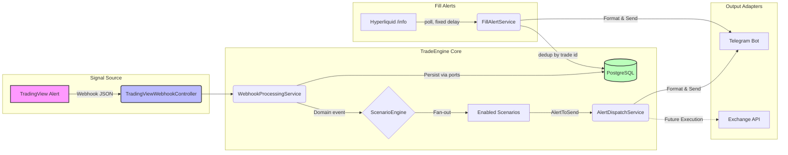
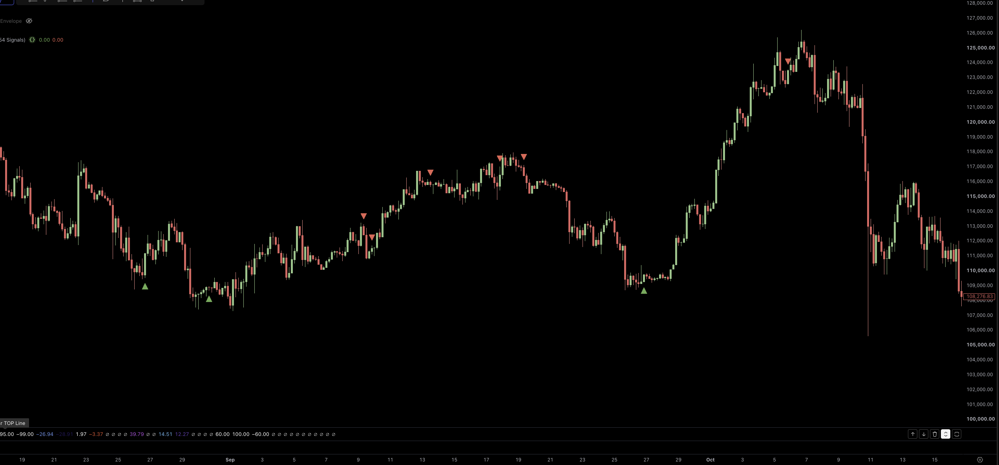
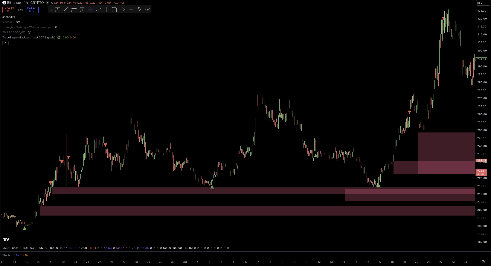
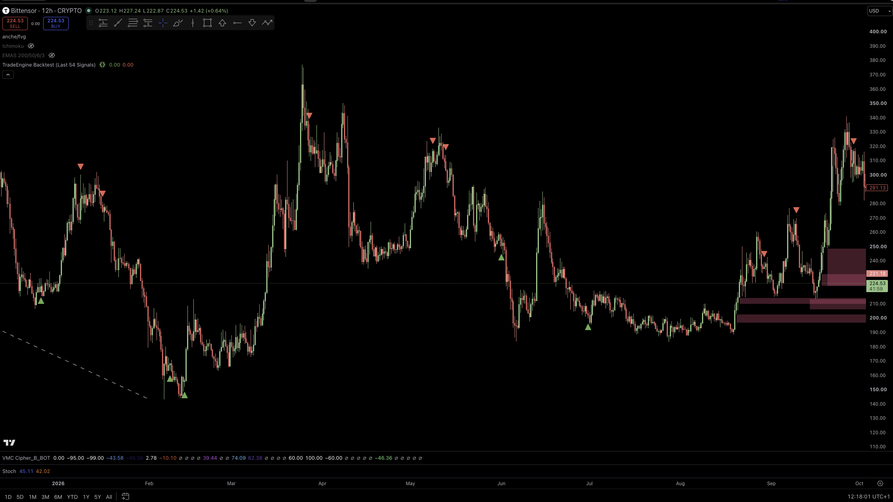
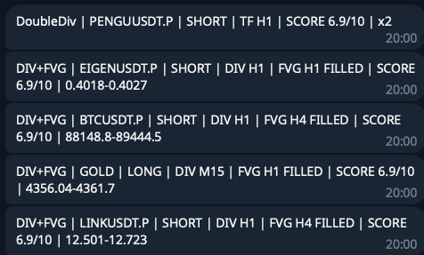
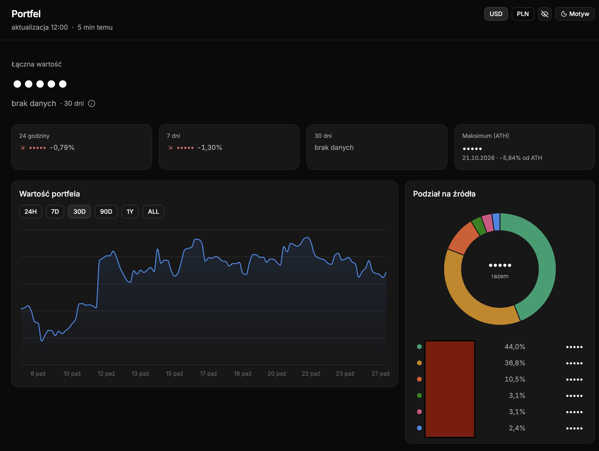
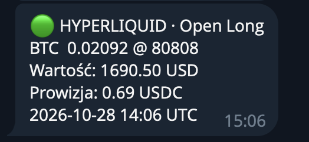
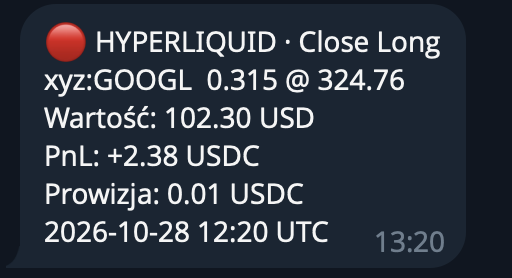

# TradeEngine - Crypto Trading Signal Engine based on Price Action

[]()
[](https://www.oracle.com/java/)
[](https://spring.io/projects/spring-boot)
[](https://www.postgresql.org/)

**TradeEngine** is a backend system that generates trading alerts from **Price Action** analysis and **Smart Money Concepts (SMC)**. It identifies key market structures (Fair Value Gaps, Key Levels, market bias) and combines them with momentum confirmations (Divergences, WaveTrend crosses); the trading decision stays with a human. Whether the alerts carry an edge is measured in [Backtesting](#-backtesting).

Currently operating as a real-time **Signal Provider** (via Telegram integration), the architecture is designed to support full **Order Execution** in future iterations. A second, independent module tracks a crypto **portfolio** and feeds a dashboard — see [Portfolio module](#-portfolio-module) — and a third notifies on Telegram whenever an order actually fills on the exchange, see [Fill alerts](#-fill-alerts-hyperliquid--telegram).

---
## 🏗 System Architecture

Hexagonal / ports-and-adapters with a DDD domain layer. The following diagram illustrates the data
flow from the signal source to the notification engine.


`AlertPublisher` is profile-bound: Telegram in `prod`, a logging publisher in `dev` and `test`. The
fill alerts enter from the opposite side — the application polls the exchange instead of being
pushed to — and travel over their own one-method port, `NotificationPublisher`, bound the same way.

## 🚀 Key Features

*   **DDD Architecture (Domain-Driven Design):** Clear separation of concerns ensuring scalable business logic.
*   **Event-Driven Approach:** Every market signal is treated as a distinct domain event for auditability.
*   **Data-Driven Strategy Enablement:** Strategies are switched on and bound to timeframes from YAML (`app.strategies`), with no code change and no redeploy.
*   **Standalone Backtesting:** The same scenario code runs headless against historical CSV candles and exports results as Pine Script overlays.
*   **Fill Notifications:** A Telegram message whenever an order fills on Hyperliquid — spot, leveraged and liquidations — deduplicated by the exchange's own trade id, so a message is never sent twice or lost across a restart.
*   **Secure Ingress:** Cloudflare Tunnel / Zero Trust configuration preventing public IP exposure.

## 🧠 Strategy Logic & Algorithms

The system operates on a **Dynamic Multi-Timeframe (MTF) Correlation Engine**. Four strategy
implementations (five beans) follow the **Context + Trigger** model, and each one is enabled per
profile:

| Strategy (`name()`) | dev | prod |
| --- | --- | --- |
| `DOUBLE_DIVERGENCE_STRATEGY` | off | **on** |
| `GRINDER_SWING_D1_H1` | off | **on** |
| `GRINDER_POSITION_W1_H4` | off | **on** |
| `FVG_LTF_CONFIRMATION` | **on** | off |
| `FVG_KEYLEVEL_DIVERGENCE_STRATEGY` | off | off |

### 1. The "Multi-Divergence" Strategy
A pure momentum strategy that seeks trend exhaustion on higher timeframes.
*   **Logic:** Scans for **multiple divergences** in the same direction within a rolling 35-candle window, on **H1, H2, H4, H8, H12, D1**.
*   **Trigger:** A divergence stack (double or more) fires an alert. On **H12 and D1 a single divergence is already sufficient** — at that scale the HTF context carries the signal on its own.
*   **Alert Metadata:** Signal strength is classified by divergence count (`x1`, `x2`, `x3` …) to prioritize stronger reversal signals.

### 2. The "Grinder" Strategy — three timeframes at once
A trend-following SMC strategy, parameterized so one implementation drives two trading horizons:

| Bean | Bias | HTF POI zones | LTF trigger |
| --- | --- | --- | --- |
| `GRINDER_SWING_D1_H1` | D1 | H4, D1 | H1 |
| `GRINDER_POSITION_W1_H4` | W1 | D1, W1 | H4 |

*   **Context:** Market bias is derived on the bias timeframe from momentum alerts; FVG zones are collected on the POI timeframes.
*   **Trigger:** A swing point on the LTF, gated by the last swing direction, in a zone aligned with the bias.

### 3. FVG + LTF Confirmation
A "Return to Value" strategy operating on a structural HTF context and a low-timeframe trigger.
*   **HTF Context:** An FVG on **H1 or H4** is touched and the zone becomes *armed* (H4 preferred over H1 when both exist). No alert at this stage.
*   **LTF Trigger (either one):** a **divergence** on M1–H4, subject to a minimum count inside a 40-candle window (M1 → 4, M3 → 2, M5/M15/H1/H4 → 1), **or** an **LTF FVG** created on M5/M15/H1 in the same direction as the armed zone.
*   Risk fields (`sl`, `tp`) are deliberately empty — risk management is not in scope yet.

*Example workflow: H4 Bearish FVG touched -> zone armed -> M15 Bearish Divergence confirmed -> 🚨 Alert Sent.*

### 4. FVG + Key Level + Divergence (currently disabled)
Mitigation of an FVG that coincides with a key level on **H1/H4/D1**, confirmed by an **M5/M15**
divergence. Implemented and covered by tests, but switched off in both profiles.

### 🧩 Signal Generation

The system relies on **proprietary algorithms** developed in **Pine Script** (hosted on TradingView). Unlike generic parsers, the backend is tuned to process specific, pre-validated payloads containing rich metadata (e.g., divergence strength, FVG coordinates) rather than simple trigger alerts. The DTOs in `application/dto/` and the `fromCode` / `fromSignal` / `fromSignalType` mappers define that wire contract.

The engine is **symbol-agnostic** — a symbol is whatever code the alert carries, so adding a market means adding a TradingView alert, not a code change. Timeframes are a closed set: **M1, M3, M5, M15, H1, H2, H4, H8, H12, D1, W1** (H2/H8/H12 added most recently).

### 🔁 Backtesting

Two plain `main`s with no Spring context replay CSV candles from `data/` (BTC, TAO, NASDAQ, GOLD,
USDPLN), back the real scenarios with in-memory repositories and synthesize the same domain events
the webhook flow produces. Output is Pine Script written to `output/`, to be overlaid back on the
chart.

- `BacktestApplication` runs both Grinder scenarios.
- `DoubleDivergenceBacktest [timeframe] [asset]` runs the double-divergence strategy on one
  timeframe. Divergences are recomputed from the candles by a 1:1 port of the VuManChu Cipher B
  WaveTrend divergence logic, the indicator that produces the live alerts.
- `scripts/forward_returns.py <csv> <pine> <bar-hours>` measures what the exported signals did
  next, against random entries (see below).

The loader takes TradingView CSV exports as they come (UNIX time, extra columns) and drops the
last bar if it has not closed yet.

The trigger depends on the timeframe: up to H8 a signal needs a **second** divergence in the same
direction within 35 candles, on H12 and D1 a **single** one is enough.

#### Example output: BTC H4 and TAO H1 / H12



*BTC H4, two divergences required. Aug 19 – Oct 16, 2025: 9 of the 54 signals exported since July
2022. ▲ bullish, ▼ bearish (a short entry, or a cue to close or trim a long). Each marker sits on the bar that opens when the live alert would have
fired.* The long on Sep 26 at ~109.2k was up 7.5% five days later, at the start of the run to
126k. The two shorts on Sep 9 lost 2.5% and 3.9% as the September rally kept going.



*TAO H1, two divergences required. Aug 17 – Sep 24, 2026, out of 207 signals since January 2024.*



*TAO H12, one divergence is enough. Dec 2025 – Oct 2026, out of 54 signals since April 2023.*

By eye, H12 looks like the cleaner of the two: fewer markers, several of them on the major turns
(the February low, the March and May tops). **Measuring every signal did not confirm that.**

#### Measured: forward returns of every exported signal

Entry at the open of the signal bar, exit at the close N bars later, return signed by direction,
no fees. The baseline puts each signal, with its own direction, on a random bar of the same
period (2000 runs). `p` is the share of random runs that did at least as well as the signals.

| Instrument | TF | Trigger | Signals | Period | Mean, 3 days | Mean, 5 days | Mean, 10 days | Random, 5 days | p, 5 days |
| --- | --- | --- | ---: | --- | ---: | ---: | ---: | ---: | ---: |
| BTC | H4 | 2+ divergences | 54 | 2022-07 – 2026-01 | −0.19% | +0.55% | +0.90% | −0.22% | 0.15 |
| TAO | H1 | 2+ divergences | 207 | 2024-01 – 2026-11 | +1.04% | +0.97% | +0.58% | +0.03% | 0.15 |
| TAO | H12 | 1 divergence | 54 | 2023-04 – 2026-11 | −1.75% | −1.43% | −2.31% | +0.21% | 0.80 |

What the numbers say:

- **No configuration has a demonstrated edge.** At five days the lowest p-value is 0.15. The best
  value overall, 0.07 (TAO H1 at 3 days), is the best of twelve tests (three configurations × four
  horizons, the script also checks 1 day), so it is weaker than it looks. It is also optimistic: clustered divergences fire on
  neighbouring bars, so the signals are not independent.
- **The visual review was wrong about H12.** Its signals did *worse* than random entries, and the
  cause is one-sided: H12 longs made +1.8% in five days, H12 shorts lost 5.5% (−9.5% at ten
  days). Picking out the well-placed markers by eye hid that.
- **As short entries, ▼ signals are the weak side everywhere.** At five days the short side
  averages +0.18% on BTC H4 and +0.03% on TAO H1, against +1.30% and +1.78% for the longs. That
  matches the losing trades on the charts: shorts fired into a rising market.
- **As exits from a long, they look better, except on H12.** An exit has to beat leaving at a
  random moment, which in a rising market costs the drift. Five days after a ▼ signal price moved
  −0.18% on BTC H4 and −0.03% on TAO H1, against +0.70% and +0.57% for an average five-day window
  in the same period: leaving on the signal avoided most of the move a random exit would have
  given up. On TAO H12 price rose +5.5% after a ▼ signal, against +1.4% on average, so exiting
  there gave up four times the usual gain. These exit figures carry no p-value yet.

H1 and H12 differ in **three** things at once: timeframe, trigger threshold and the period the
data covers (H1 starts in January 2024, H12 in April 2023). The difference between them therefore
cannot be pinned on any one of these.

Next steps, one variable at a time:

1. H12 with two divergences required, on the same dates as now: the effect of the threshold.
2. H1 with a single divergence, cut to the same dates as H12: the effect of the timeframe.
3. Long-only, with ▼ markers tested as exits rather than entries (with their own random-exit
   baseline and p-value), and a D1/W1 bias gate on the bearish side (the one Grinder already
   uses). As shorts, the bearish side is weakest in all three runs, so that is where an edge is
   most likely to come from.
4. NASDAQ H1–D1 is already exported (`data/nasdaq_*.csv`) and is the out-of-sample check: an
   instrument that took no part in choosing the rules.

## 📸 Live Signal Example

*Screenshot of a live alert delivered via Telegram during a recent BTC retracement:*



## 💼 Portfolio module

An independent module in the same application: it takes an hourly snapshot of a crypto portfolio
and exposes a read API for a dashboard. It shares only the Spring context and the database with the
trading strategies.

*   **Sources:** EVM addresses over JSON-RPC (ethereum, arbitrum, bsc), Bitcoin from an xpub via Blockbook, Hyperliquid (spot, perps equity, staking), Coinbase via the CDP API, plus manually entered amounts for what no API exposes.
*   **Pricing:** CoinMarketCap, in USD and PLN — both totals are stored, because history and ATH are computed per currency.
*   **Degradation:** a failing source never invents numbers. Amounts carry forward from the last conclusive snapshot, the position is flagged `stale` and the snapshot `complete=false`.
*   **API:** `GET /api/portfolio/summary`, `GET /api/portfolio/history`, `POST /api/portfolio/snapshots`, `GET|PUT /api/portfolio/manual-holdings`. **[`docs/portfolio-api.md`](docs/portfolio-api.md) is the source of truth for the response shapes.**
*   **UI:** a dashboard in a separate repository, served by Spring from a directory next to the jar — see below.

`taken_at` is truncated to the full UTC hour and is unique, so a repeated snapshot within the same
hour replaces the previous one. A failing snapshot is logged and never kills the schedule — the next
hour tries again. Addresses and API keys are read exclusively from outside the repository; a missing
variable is a log warning, never a startup failure.

### Dashboard

A single-page view (Vite + React) living in its own repository, built with `base: '/'` and uploaded
to a directory on the production machine. Spring serves it from outside the jar, so releasing the
front end never forces a backend redeploy and the origin stays single — no CORS, no second Access
policy.



*Amounts are masked by the built-in privacy toggle — the dashboard runs against a live portfolio.*

What the view carries: the total with the time of the last snapshot, change tiles for 24 h / 7 d /
30 d and the distance from the all-time high, a value chart over a selectable range
(24H / 7D / 30D / 90D / 1Y / ALL), and a donut splitting the portfolio by source. A currency switch
(USD / PLN) re-reads both from the API rather than converting client-side, because history and ATH
are tracked per currency. A theme switch and a privacy toggle that hides every amount round it out.

Two behaviours worth naming:

*   **`brak danych` is shown, not a zero.** A window longer than the collected history (the `30 dni` tile above) stays empty instead of implying a flat portfolio.
*   **After an API error the front end never substitutes demo data** — mock mode exists only behind an explicit build flag. Quietly slipping fictional numbers into a view where financial decisions are made is worse than an error message.

## 🔔 Fill alerts (Hyperliquid → Telegram)

The strategies tell you what *might* be worth doing; this tells you what **actually happened on the
account**. A fixed-delay poll of Hyperliquid's public `/info` API sends a Telegram message whenever
an order of the configured address fills — a spot buy or sell, a leveraged open or reduce, and a
liquidation too. It reuses the portfolio's Hyperliquid connector, address and spot whitelist, so it
needs **no new environment variable** and no key: the address goes in the request body.

| Opening a position | Closing it |
| --- | --- |
|  |  |

*Two real messages from the channel: an opening fill carries the fee, a closing one adds the
realised PnL. The symbol is printed exactly as the exchange names that market — hence
`xyz:GOOGL` rather than a ticker of our own.*

The header is the API's own `dir` field, copied verbatim. There is **no branch for liquidation
anywhere in the code** — an event nobody foresaw describes itself (`Liquidated Isolated Long`),
which is the whole point of not mapping that field onto an enum of our own.

Three decisions that are not obvious from the code:

*   **Deduplication is by the exchange's trade id, not by time.** The `startTime` bound is inclusive and several fills can share a millisecond, so the last handled fill comes back on every poll; what rejects it is a primary key. One table is both the cursor (`max(fill_time)`) and the dedup set.
*   **An empty table means "first run", not "nothing happened".** The API remembers up to 10 000 fills, so a first run records the recent ones **without notifying** and sends a single confirmation message instead — which doubles as proof that the whole path to Telegram works.
*   **A backlog is capped per run.** After an outage a poll can see dozens of fills; the oldest are sent and the rest are closed with one summary line. A flooded channel is worse than a lost detail.

A WebSocket subscription would push in a second rather than in up to a minute, but it adds
reconnects, keepalives and snapshot-frame filtering; at a request weight of 20 against 1200 per
minute, polling costs about 3% of the budget and far less code. Funding, transfers and TWAP slice
fills are separate endpoints and deliberately not read.

## 🛠️ Tech Stack & Infrastructure

### Core Backend
*   **Language:** Java 25 — utilizing Records and Pattern Matching.
*   **Framework:** Spring Boot 3.5 (Web, Data JPA).
*   **Database:** PostgreSQL in prod (`ddl-auto: validate`), H2 in-memory in dev and tests.
*   **Tools:** Lombok, Maven, springdoc (OpenAPI 3.1).

### Testing
*   JUnit 5 + Mockito + AssertJ, 43 test classes; JaCoCo report on every `mvn test` (`target/site/jacoco/index.html`).
*   Repositories are never mocked — the in-memory adapters from `backtest/` serve as fakes, and collaborators are asserted through recording fakes rather than `verify`.

### Connectivity & Security
*   **Ingress:** **Cloudflare Tunnel (Zero Trust)** — webhook endpoints stay open (TradingView cannot authenticate), everything else is gated by Cloudflare Access and a default-deny WAF rule on the webhook host.
*   **Signal Source:** TradingView Webhooks (JSON payloads).
*   **Notification:** Telegram Bot API.

### Environment
*   **Current Deployment:** self-hosted on-premise machine (Windows) behind Cloudflare, with a separate macOS development environment.

## 📂 Source layout

```
src/main/java/pl/tradeengine/
├── adapter/
│   ├── inbound/        — REST controllers (TradingView webhooks, signals, FVG admin, portfolio)
│   └── outbound/       — Telegram publisher, JPA adapters, EVM / CMC / Blockbook clients
├── application/        — DTOs and orchestration (WebhookProcessingService, AlertDispatchService)
├── backtest/           — Standalone runner (no Spring), in-memory repos, Pine Script export
├── config/             — Spring config, StrategyProperties, ScenarioRegistry
└── domain/
    ├── event/          — DomainEvent hierarchy (FvgCreated/Touched/Filled, DivergenceDetected, …)
    ├── model/          — Value objects and enums (FvgZone, AlertToSend, Timeframe, Direction, …)
    ├── port/           — Repository + AlertPublisher interfaces
    ├── scenario/       — Strategy implementations + ScenarioEngine
    └── util/           — PriceFormatter, PriceCandleUtils
```

The portfolio module lives in a `portfolio/` sub-package of each layer and the fill alerts in a
`fill/` one, sharing the Hyperliquid connector with the portfolio; the hand-run PostgreSQL schema
for both is in `sql/portfolio_schema.sql`.

## ⚙️ Build & Run

JDK 25 and Maven 3.9+ required. The Maven wrapper is **not** committed, so use a system `mvn`.

```bash
mvn clean package                 # build
mvn test                          # run the test suite + coverage report
mvn spring-boot:run               # dev profile, H2 in-memory, port 8081
mvn exec:java -Dexec.mainClass=pl.tradeengine.backtest.BacktestApplication
```

The `dev` profile is active by default; `prod` (PostgreSQL, port 8080) is selected with
`-Dspring.profiles.active=prod`.

### Backtest analysis

```bash
mvn compile exec:java -Dexec.mainClass=pl.tradeengine.backtest.DoubleDivergenceBacktest -Dexec.args="H12 tao"
pip install -r scripts/requirements.txt   # standard library only, nothing to install today
python3 scripts/forward_returns.py data/tao_h12.csv output/tao_double_divergence_h12.pine 12
```

`output/` is not in git: the `.pine` file is generated by the first command. Arguments are
`[timeframe] [asset] [start-date]`; BTC exports drop the asset prefix
(`H4 btc` → `output/double_divergence_h4.pine`).


### Required environment variables

| Variable | Role |
| --- | --- |
| `DB_USER`, `DB_PASSWORD` | Datasource credentials. In dev `sa` / empty is enough. |
| `TELEGRAM_BOT_TOKEN`, `TELEGRAM_CHAT_ID` | Read at startup in both profiles; the Telegram publisher itself is `prod`-only. |

Without the first pair the context does not start. The portfolio module adds its own optional
variables (CMC key, wallet addresses) — all defaulted to empty and supplied from outside the repo.

### Other endpoints

`GET /api/signals/divergences` (recent divergence signals), `/admin/fvg` (FVG inspection),
`/v3/api-docs` (OpenAPI schema, always on), `/swagger-ui.html` and `/h2-console` (dev only).

## 🚧 Roadmap & Future Improvements

The project is continuously evolving from a signal provider into a full-stack trading platform.

### 🔹 Core Execution & Risk Management
- [ ] **Exchange Integration:** Order execution for **Bybit** and **Hyperliquid**. (Hyperliquid is already read from — for the portfolio module and for [fill alerts](#-fill-alerts-hyperliquid--telegram) — but that connector is read-only: it reports fills, it does not place orders.)
- [ ] **Smart Risk Engine:** Automated position sizing based on Account Equity % and dynamic Stop Loss levels. Scenarios currently emit alerts with empty `sl` / `tp`.
- [ ] **Trade Management:** Logic for Breakeven triggers, Trailing Stops, and Partial Take Profits.

### 🔹 Strategies & Backtesting
- [x] **Backtesting Engine:** Standalone runner over historical CSV candles with Pine Script export — see [Backtesting](#-backtesting). Covers the Grinder scenarios and the double-divergence strategy; the two FVG strategies have no backtest path yet.
- [ ] **Strategy Versioning:** Mechanism to manage multiple versions of strategy logic (e.g., `v1.0` vs `v1.2`) simultaneously.
- [x] **Strategy Enablement from Configuration:** `app.strategies` decides which strategies run and on which timeframes, without a redeploy.
- [ ] **Dynamic Parameterization:** Thresholds themselves (lookback windows, minimum divergence counts, FVG timing constants) are still compile-time constants and should move to configuration.

### 🔹 UI & Analytics (Web Dashboard)
- [x] **Portfolio Dashboard:** Live, in a separate repository, served from the same origin — see [Portfolio module](#-portfolio-module).
- [ ] **Admin Dashboard:** A graphical interface to toggle active strategies and manage configuration.
- [ ] **Performance Analytics:** Visualization of Win Rate, Profit Factor, and Drawdown curves.
- [ ] **Signal History:** Searchable table of all past alerts and their outcomes.

### 🔹 DevOps & Infrastructure
- [ ] **Dockerization:** Full containerization of the Spring Boot app and PostgreSQL database.
- [ ] **CI/CD Pipeline:** GitHub Actions workflows for automated testing and building.
