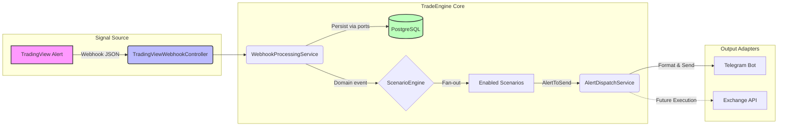
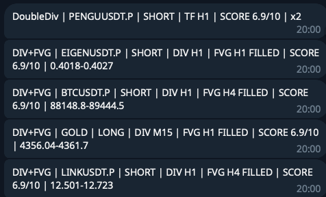
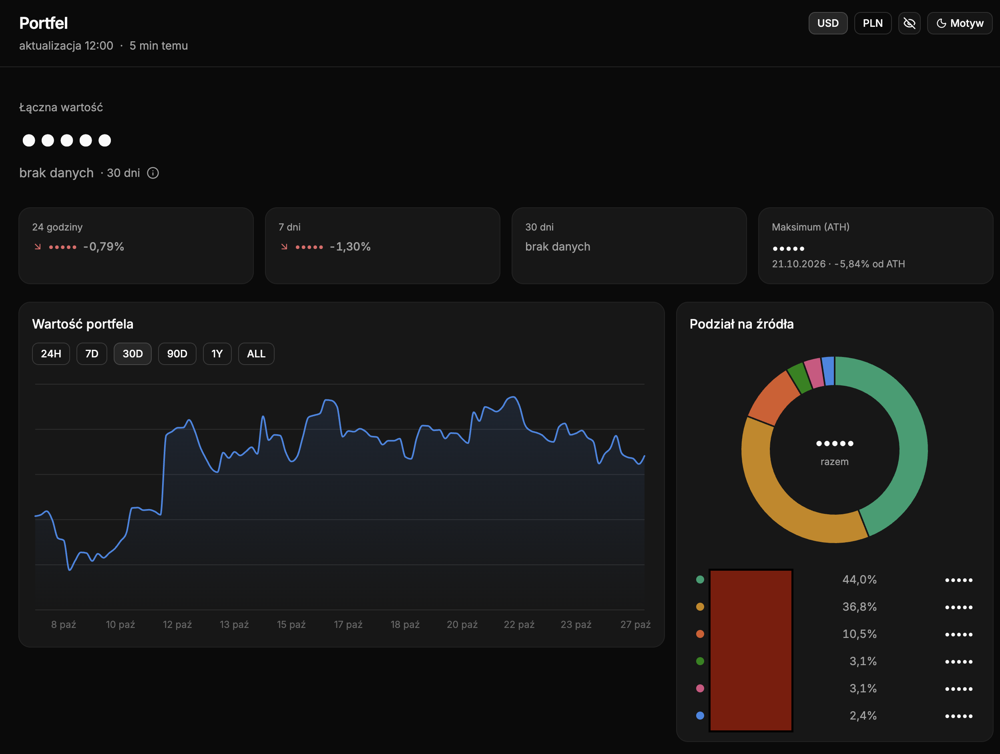

# TradeEngine - Automated Crypto Trading Bot based on Price Action

[]()
[](https://www.oracle.com/java/)
[](https://spring.io/projects/spring-boot)
[](https://www.postgresql.org/)

**TradeEngine** is an advanced backend system for automated trading, built on **Price Action** analysis and **Smart Money Concepts (SMC)**. The application identifies key market structures (Fair Value Gaps, Key Levels, market bias) and combines them with momentum confirmations (Divergences, WaveTrend crosses) to generate **High Probability Setups**.

Currently operating as a real-time **Signal Provider** (via Telegram integration), the architecture is designed to support full **Order Execution** in future iterations. A second, independent module tracks a crypto **portfolio** and feeds a dashboard — see [Portfolio module](#-portfolio-module).

---
## 🏗 System Architecture

Hexagonal / ports-and-adapters with a DDD domain layer. The following diagram illustrates the data
flow from the signal source to the notification engine.


`AlertPublisher` is profile-bound: Telegram in `prod`, a logging publisher in `dev` and `test`.

## 🚀 Key Features

*   **DDD Architecture (Domain-Driven Design):** Clear separation of concerns ensuring scalable business logic.
*   **Event-Driven Approach:** Every market signal is treated as a distinct domain event for auditability.
*   **Data-Driven Strategy Enablement:** Strategies are switched on and bound to timeframes from YAML (`app.strategies`), with no code change and no redeploy.
*   **Standalone Backtesting:** The same scenario code runs headless against historical CSV candles and exports results as Pine Script overlays.
*   **Secure Ingress:** Cloudflare Tunnel / Zero Trust configuration preventing public IP exposure.

## 🧠 Strategy Logic & Algorithms

The system operates on a **Dynamic Multi-Timeframe (MTF) Correlation Engine**. Four strategy
implementations (five beans) follow the **Context + Trigger** model, and each one is enabled per
profile:

| Strategy (`name()`) | dev | prod |
| --- | --- | --- |
| `DOUBLE_DIVERGENCE_STRATEGY` | off | **on** |
| `GRINDER_SWING_D1_H1` | off | **on** |
| `GRINDER_POSITION_W1_H4` | off | **on** |
| `FVG_LTF_CONFIRMATION` | **on** | off |
| `FVG_KEYLEVEL_DIVERGENCE_STRATEGY` | off | off |

### 1. The "Multi-Divergence" Strategy
A pure momentum strategy that seeks trend exhaustion on higher timeframes.
*   **Logic:** Scans for **multiple divergences** in the same direction within a rolling 35-candle window, on **H1, H2, H4, H8, H12, D1**.
*   **Trigger:** A divergence stack (double or more) fires an alert. On **H12 and D1 a single divergence is already sufficient** — at that scale the HTF context carries the signal on its own.
*   **Alert Metadata:** Signal strength is classified by divergence count (`x1`, `x2`, `x3` …) to prioritize stronger reversal signals.

### 2. The "Grinder" Strategy — three timeframes at once
A trend-following SMC strategy, parameterized so one implementation drives two trading horizons:

| Bean | Bias | HTF POI zones | LTF trigger |
| --- | --- | --- | --- |
| `GRINDER_SWING_D1_H1` | D1 | H4, D1 | H1 |
| `GRINDER_POSITION_W1_H4` | W1 | D1, W1 | H4 |

*   **Context:** Market bias is derived on the bias timeframe from momentum alerts; FVG zones are collected on the POI timeframes.
*   **Trigger:** A swing point on the LTF, gated by the last swing direction, in a zone aligned with the bias.

### 3. FVG + LTF Confirmation
A "Return to Value" strategy operating on a structural HTF context and a low-timeframe trigger.
*   **HTF Context:** An FVG on **H1 or H4** is touched and the zone becomes *armed* (H4 preferred over H1 when both exist). No alert at this stage.
*   **LTF Trigger (either one):** a **divergence** on M1–H4, subject to a minimum count inside a 40-candle window (M1 → 4, M3 → 2, M5/M15/H1/H4 → 1), **or** an **LTF FVG** created on M5/M15/H1 in the same direction as the armed zone.
*   Risk fields (`sl`, `tp`) are deliberately empty — risk management is not in scope yet.

*Example workflow: H4 Bearish FVG touched -> zone armed -> M15 Bearish Divergence confirmed -> 🚨 Alert Sent.*

### 4. FVG + Key Level + Divergence (currently disabled)
Mitigation of an FVG that coincides with a key level on **H1/H4/D1**, confirmed by an **M5/M15**
divergence. Implemented and covered by tests, but switched off in both profiles.

### 🧩 Signal Generation

The system relies on **proprietary algorithms** developed in **Pine Script** (hosted on TradingView). Unlike generic parsers, the backend is tuned to process specific, pre-validated payloads containing rich metadata (e.g., divergence strength, FVG coordinates) rather than simple trigger alerts. The DTOs in `application/dto/` and the `fromCode` / `fromSignal` / `fromSignalType` mappers define that wire contract.

The engine is **symbol-agnostic** — a symbol is whatever code the alert carries, so adding a market means adding a TradingView alert, not a code change. Timeframes are a closed set: **M1, M3, M5, M15, H1, H2, H4, H8, H12, D1, W1** (H2/H8/H12 added most recently).

### 🔁 Backtesting

`BacktestApplication` is a plain `main` with no Spring context: it instantiates the Grinder
scenarios directly, backs them with in-memory repositories, replays CSV candles from `data/`
(BTCUSDT, GOLD, USDPLN at H1/H4/D1/W1) and synthesizes the same domain events the webhook flow
produces. Output is Pine Script written to `output/`, to be overlaid back on the chart.

## 📸 Live Signal Example

*Screenshot of a live alert delivered via Telegram during a recent BTC retracement:*



## 💼 Portfolio module

An independent module in the same application: it takes an hourly snapshot of a crypto portfolio
and exposes a read API for a dashboard. It shares only the Spring context and the database with the
trading strategies.

*   **Sources:** EVM addresses over JSON-RPC (ethereum, arbitrum, bsc), Bitcoin from an xpub via Blockbook, Hyperliquid (spot, perps equity, staking), Coinbase via the CDP API, plus manually entered amounts for what no API exposes.
*   **Pricing:** CoinMarketCap, in USD and PLN — both totals are stored, because history and ATH are computed per currency.
*   **Degradation:** a failing source never invents numbers. Amounts carry forward from the last conclusive snapshot, the position is flagged `stale` and the snapshot `complete=false`.
*   **API:** `GET /api/portfolio/summary`, `GET /api/portfolio/history`, `POST /api/portfolio/snapshots`, `GET|PUT /api/portfolio/manual-holdings`. **[`docs/portfolio-api.md`](docs/portfolio-api.md) is the source of truth for the response shapes.**
*   **UI:** a dashboard in a separate repository, served by Spring from a directory next to the jar — see below.

`taken_at` is truncated to the full UTC hour and is unique, so a repeated snapshot within the same
hour replaces the previous one. A failing snapshot is logged and never kills the schedule — the next
hour tries again. Addresses and API keys are read exclusively from outside the repository; a missing
variable is a log warning, never a startup failure.

### Dashboard

A single-page view (Vite + React) living in its own repository, built with `base: '/'` and uploaded
to a directory on the production machine. Spring serves it from outside the jar, so releasing the
front end never forces a backend redeploy and the origin stays single — no CORS, no second Access
policy.



*Amounts are masked by the built-in privacy toggle — the dashboard runs against a live portfolio.*

What the view carries: the total with the time of the last snapshot, change tiles for 24 h / 7 d /
30 d and the distance from the all-time high, a value chart over a selectable range
(24H / 7D / 30D / 90D / 1Y / ALL), and a donut splitting the portfolio by source. A currency switch
(USD / PLN) re-reads both from the API rather than converting client-side, because history and ATH
are tracked per currency. A theme switch and a privacy toggle that hides every amount round it out.

Two behaviours worth naming:

*   **`brak danych` is shown, not a zero.** A window longer than the collected history (the `30 dni` tile above) stays empty instead of implying a flat portfolio.
*   **After an API error the front end never substitutes demo data** — mock mode exists only behind an explicit build flag. Quietly slipping fictional numbers into a view where financial decisions are made is worse than an error message.

## 🛠️ Tech Stack & Infrastructure

### Core Backend
*   **Language:** Java 25 — utilizing Records and Pattern Matching.
*   **Framework:** Spring Boot 3.5 (Web, Data JPA).
*   **Database:** PostgreSQL in prod (`ddl-auto: validate`), H2 in-memory in dev and tests.
*   **Tools:** Lombok, Maven, springdoc (OpenAPI 3.1).

### Testing
*   JUnit 5 + Mockito + AssertJ, 36 test classes; JaCoCo report on every `mvn test` (`target/site/jacoco/index.html`).
*   Repositories are never mocked — the in-memory adapters from `backtest/` serve as fakes, and collaborators are asserted through recording fakes rather than `verify`.

### Connectivity & Security
*   **Ingress:** **Cloudflare Tunnel (Zero Trust)** — webhook endpoints stay open (TradingView cannot authenticate), everything else is gated by Cloudflare Access and a default-deny WAF rule on the webhook host.
*   **Signal Source:** TradingView Webhooks (JSON payloads).
*   **Notification:** Telegram Bot API.

### Environment
*   **Current Deployment:** self-hosted on-premise machine (Windows) behind Cloudflare, with a separate macOS development environment.

## 📂 Source layout

```
src/main/java/pl/tradeengine/
├── adapter/
│   ├── inbound/        — REST controllers (TradingView webhooks, signals, FVG admin, portfolio)
│   └── outbound/       — Telegram publisher, JPA adapters, EVM / CMC / Blockbook clients
├── application/        — DTOs and orchestration (WebhookProcessingService, AlertDispatchService)
├── backtest/           — Standalone runner (no Spring), in-memory repos, Pine Script export
├── config/             — Spring config, StrategyProperties, ScenarioRegistry
└── domain/
    ├── event/          — DomainEvent hierarchy (FvgCreated/Touched/Filled, DivergenceDetected, …)
    ├── model/          — Value objects and enums (FvgZone, AlertToSend, Timeframe, Direction, …)
    ├── port/           — Repository + AlertPublisher interfaces
    ├── scenario/       — Strategy implementations + ScenarioEngine
    └── util/           — PriceFormatter, PriceCandleUtils
```

The portfolio module lives in a `portfolio/` sub-package of each layer; its hand-run PostgreSQL
schema is in `sql/portfolio_schema.sql`.

## ⚙️ Build & Run

JDK 25 and Maven 3.9+ required. The Maven wrapper is **not** committed, so use a system `mvn`.

```bash
mvn clean package                 # build
mvn test                          # run the test suite + coverage report
mvn spring-boot:run               # dev profile, H2 in-memory, port 8081
mvn exec:java -Dexec.mainClass=pl.tradeengine.backtest.BacktestApplication
```

The `dev` profile is active by default; `prod` (PostgreSQL, port 8080) is selected with
`-Dspring.profiles.active=prod`.

### Required environment variables

| Variable | Role |
| --- | --- |
| `DB_USER`, `DB_PASSWORD` | Datasource credentials. In dev `sa` / empty is enough. |
| `TELEGRAM_BOT_TOKEN`, `TELEGRAM_CHAT_ID` | Read at startup in both profiles; the Telegram publisher itself is `prod`-only. |

Without the first pair the context does not start. The portfolio module adds its own optional
variables (CMC key, wallet addresses) — all defaulted to empty and supplied from outside the repo.

### Other endpoints

`GET /api/signals/divergences` (recent divergence signals), `/admin/fvg` (FVG inspection),
`/v3/api-docs` (OpenAPI schema, always on), `/swagger-ui.html` and `/h2-console` (dev only).

## 🚧 Roadmap & Future Improvements

The project is continuously evolving from a signal provider into a full-stack trading platform.

### 🔹 Core Execution & Risk Management
- [ ] **Exchange Integration:** Order execution for **Bybit** and **Hyperliquid**. (Hyperliquid is already read from for the portfolio module — that connector is read-only, no trading.)
- [ ] **Smart Risk Engine:** Automated position sizing based on Account Equity % and dynamic Stop Loss levels. Scenarios currently emit alerts with empty `sl` / `tp`.
- [ ] **Trade Management:** Logic for Breakeven triggers, Trailing Stops, and Partial Take Profits.

### 🔹 Strategies & Backtesting
- [x] **Backtesting Engine:** Standalone runner over historical CSV candles with Pine Script export — see [Backtesting](#-backtesting). Covers the Grinder scenarios; the Spring-only strategies have no backtest path yet.
- [ ] **Strategy Versioning:** Mechanism to manage multiple versions of strategy logic (e.g., `v1.0` vs `v1.2`) simultaneously.
- [x] **Strategy Enablement from Configuration:** `app.strategies` decides which strategies run and on which timeframes, without a redeploy.
- [ ] **Dynamic Parameterization:** Thresholds themselves (lookback windows, minimum divergence counts, FVG timing constants) are still compile-time constants and should move to configuration.

### 🔹 UI & Analytics (Web Dashboard)
- [x] **Portfolio Dashboard:** Live, in a separate repository, served from the same origin — see [Portfolio module](#-portfolio-module).
- [ ] **Admin Dashboard:** A graphical interface to toggle active strategies and manage configuration.
- [ ] **Performance Analytics:** Visualization of Win Rate, Profit Factor, and Drawdown curves.
- [ ] **Signal History:** Searchable table of all past alerts and their outcomes.

### 🔹 DevOps & Infrastructure
- [ ] **Dockerization:** Full containerization of the Spring Boot app and PostgreSQL database.
- [ ] **CI/CD Pipeline:** GitHub Actions workflows for automated testing and building.
